# Documento técnico del pipeline CI/CD

## 1. Objetivo

El pipeline automatiza la validación del proyecto Django desde que se envía un
cambio a GitHub. Primero ejecuta las pruebas con PostgreSQL, después construye
la imagen Docker y finalmente realiza un despliegue simulado con Docker Compose.
El proceso también guarda evidencias que permiten comprobar el resultado de la
construcción y del despliegue.

## 2. Ejecución completa del pipeline

El flujo se activa mediante un `push` a las ramas configuradas o mediante un
`pull_request` dirigido a `main`. El trabajo `test` debe finalizar correctamente
antes de que comience `docker-build-deploy`. Esta dependencia evita construir o
desplegar una versión cuyo código no haya superado las pruebas.

Durante la validación final se comprobaron las siguientes etapas:

1. Descarga del código del repositorio.
2. Preparación de Python 3.10 y PostgreSQL 15.
3. Instalación de dependencias.
4. Ejecución de migraciones y pruebas de Django.
5. Construcción de la imagen Docker.
6. Preparación de una etiqueta de DockerHub simulada.
7. Publicación de la evidencia del build.
8. Inicio de Django y PostgreSQL mediante Docker Compose.
9. Validación automática de la página `/admin/login/`.
10. Publicación de registros y limpieza de los contenedores temporales.

### Figura 22. Pipeline completo ejecutado correctamente

**Dónde obtener la captura:** abrir `Actions > Django CI` en GitHub y seleccionar
la ejecución más reciente de la rama `cd-setup`. Capturar el resumen donde los
trabajos `test` y `Construir imagen y simular despliegue` aparezcan en color
verde.

**Descripción sugerida:** El pipeline completo finalizó correctamente. La
captura muestra que las pruebas de integración continua y el trabajo de
construcción y despliegue simulado fueron ejecutados sin errores.

### Figura 23. Detalle de las etapas CI, Build y despliegue simulado

**Dónde obtener la captura:** dentro de la misma ejecución, abrir el trabajo
`Construir imagen y simular despliegue` y mostrar la lista completa de pasos con
sus marcas verdes. Deben verse la construcción Docker, la publicación de los
artefactos, el inicio de Docker Compose y la validación HTTP.

**Descripción sugerida:** La captura presenta las etapas del pipeline en orden:
validación del código, construcción de la imagen Docker, preparación del
artefacto, ejecución de los contenedores y comprobación automática del sistema.

## 3. Verificación final del repositorio

La revisión final confirma que el repositorio contiene los archivos utilizados
en las cuatro sesiones:

- `.github/workflows/ci.yml`: definición del pipeline.
- `Dockerfile`: construcción de la imagen de Django.
- `docker-compose.yml`: ejecución conjunta de Django y PostgreSQL.
- `entrypoint.sh`: aplicación de migraciones antes de iniciar Django.
- `deploy-notes.md`: instrucciones del despliegue simulado.
- `pipeline-tecnico.md`: documentación técnica y resultados finales.
- `requirements.txt`: dependencias del proyecto.
- `app/` y `project/`: aplicación y configuración de Django.

### Figura 24. Repositorio final actualizado

**Dónde obtener la captura:** abrir la rama `cd-setup` en la página principal del
repositorio de GitHub. Capturar la lista de archivos procurando que sean visibles
`.github`, `app`, `project`, `Dockerfile`, `docker-compose.yml`,
`deploy-notes.md` y `pipeline-tecnico.md`.

**Descripción sugerida:** El repositorio final reúne el código Django, la
configuración de integración continua, los archivos de Docker y la documentación
necesaria para reproducir y verificar el pipeline implementado.

## 4. Diagrama del flujo CI/CD

```mermaid
flowchart LR
    trigger(["Push o pull request"])
    checkout["Obtener código"]
    environment["Preparar Python y PostgreSQL"]
    tests["Migraciones y pruebas"]
    testsOk{"¿Pruebas correctas?"}
    testFail["Corregir errores"]
    build["Construir imagen Docker"]
    tag["Preparar etiqueta DockerHub"]
    artifact["Publicar evidencia del build"]
    compose["Iniciar Docker Compose"]
    httpOk{"¿Respuesta HTTP 200?"}
    deployFail["Revisar registros"]
    evidence["Publicar evidencia del despliegue"]
    cleanup["Detener contenedores"]
    complete(["Pipeline completado"])

    trigger --> checkout
    checkout --> environment
    environment --> tests
    tests --> testsOk
    testsOk -->|"No"| testFail
    testsOk -->|"Sí"| build
    build --> tag
    tag --> artifact
    artifact --> compose
    compose --> httpOk
    httpOk -->|"No"| deployFail
    httpOk -->|"Sí"| evidence
    evidence --> cleanup
    cleanup --> complete

    style trigger fill:#C2E5FF,stroke:#3DADFF
    style testsOk fill:#FFECBD,stroke:#FFC943
    style httpOk fill:#FFECBD,stroke:#FFC943
    style testFail fill:#FFCDC2,stroke:#FF7556
    style deployFail fill:#FFCDC2,stroke:#FF7556
    style complete fill:#CDF4D3,stroke:#66D575
```

### Figura 25. Diagrama del flujo CI/CD

**Dónde obtener la captura:** abrir `pipeline-tecnico.md` desde GitHub y capturar
el diagrama renderizado en esta sección. La captura debe abarcar desde el evento
que inicia el workflow hasta la finalización del pipeline.

**Descripción sugerida:** El diagrama representa el flujo completo de CI/CD. Un
cambio en el repositorio inicia las pruebas; si son satisfactorias, se construye
la imagen Docker, se prepara el artefacto, se despliega con Docker Compose y se
valida la respuesta HTTP antes de limpiar los recursos temporales.

## 5. Explicación del archivo de GitHub Actions

### Disparadores

El bloque `on` define cuándo se ejecuta el workflow. Los eventos `push` en las
ramas de trabajo configuradas y los `pull_request` hacia `main` inician el
pipeline automáticamente.

### Trabajo de integración continua

El trabajo `test` utiliza un agente Ubuntu y crea un servicio PostgreSQL 15. Las
variables `POSTGRES_*` permiten que Django se conecte a la base de datos. Luego
se descarga el código, se configura Python 3.10, se instalan las dependencias, se
aplican las migraciones y se ejecuta `python manage.py test`.

### Construcción de Docker

El trabajo `docker-build-deploy` contiene `needs: test`, por lo que solamente
comienza cuando las pruebas terminan correctamente. El comando `docker build`
construye la imagen `practica3-django:ci` y también crea una etiqueta relacionada
con el commit ejecutado.

### Preparación del artefacto

El pipeline prepara una etiqueta con el formato que se utilizaría para publicar
la imagen en DockerHub, pero no utiliza credenciales ni realiza una publicación
real. El artefacto `evidencia-build-<SHA>` conserva el identificador de la imagen,
la etiqueta simulada y los archivos principales de despliegue.

### Despliegue simulado

Docker Compose inicia los servicios `web` y `db` usando la imagen recién
construida. El pipeline consulta `http://127.0.0.1:8000/admin/login/` hasta recibir
una respuesta correcta. Después guarda el estado, los registros y el código HTTP
en `evidencia-despliegue-<SHA>`. El último paso detiene los contenedores y elimina
el volumen temporal.

## 6. Resultados

La validación del pipeline obtuvo los siguientes resultados:

- PostgreSQL 15 inició correctamente y alcanzó el estado `healthy`.
- Las migraciones de Django se ejecutaron sin errores.
- La prueba automatizada del modelo `Tarea` fue satisfactoria.
- La imagen Docker se construyó correctamente con Python 3.10.
- Django y PostgreSQL se iniciaron mediante Docker Compose.
- La página de administración respondió con el código `HTTP 200`.
- Los artefactos del build y del despliegue se publicaron correctamente.
- Los contenedores y el volumen temporal se eliminaron al finalizar.

## 7. Recomendaciones finales

- Guardar `SECRET_KEY`, contraseñas y demás valores sensibles en secretos de
  GitHub o variables de entorno.
- Desactivar `DEBUG` y configurar `ALLOWED_HOSTS` antes de un despliegue real.
- Utilizar un servidor de producción como Gunicorn en lugar de `runserver`.
- Publicar la imagen en un registro real únicamente cuando existan credenciales
  protegidas y una política de versiones.
- Agregar más pruebas para vistas, formularios y operaciones sobre tareas cuando
  la aplicación incorpore esas funcionalidades.
- Proteger la rama `main` y exigir que el pipeline finalice correctamente antes
  de aceptar un pull request.

## 8. Evidencias complementarias

Como evidencia adicional pueden incluirse el contenido descargado de los
artefactos, la salida de `docker compose ps`, el archivo `http-status.txt` y los
registros guardados en `docker-compose-logs.txt`.
